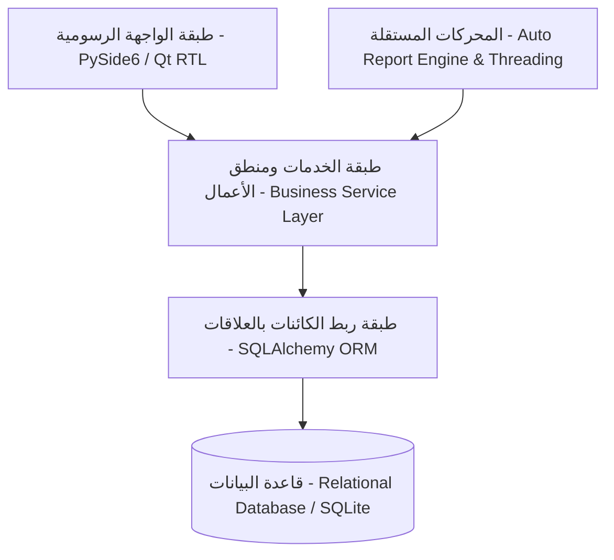

# التقرير الأكاديمي الشامل لنظام إدارة صيانة الأجهزة الطبية
## Medical Equipment Maintenance Management System (MEMMS)
### دراسة تطبيقية: هيئة مستشفى الثورة العام النموذجي — صنعاء

---

## 1. الملخص التنفيذي (Executive Summary)
يمثل نظام **MEMMS** حلاً برمجياً وهندسياً متقدماً يندرج تحت فئة أنظمة إدارة الصيانة المحوسبة الطبية (**Medical CMMS**)، والمصممة خصيصاً لإدارة دورة حياة التكنولوجيا الطبية والرعاية الصحية (**Healthcare Technology Management - HTM**). 

يهدف النظام إلى أتمتة وحوكمة كافة العمليات الهندسية والتشغيلية المتعلقة بالأصول الطبية؛ بدءاً من التكليف والاستلام الفني (**Commissioning**)، والترميز والتصنيف السريري، مروراً بجدولة الصيانة الوقائية (**Preventive Maintenance**) والمعايرة وضبط الجودة (**Calibration & Quality Control**)، وإدارة البلاغات وأوامر الصيانة التصحيحية (**Corrective Maintenance**)، وإدارة سلاسل إمداد قطع الغيار والمستودع، وانتهاءً بإدارة عقود الضمان والوكلاء المحليين ومحركات التقارير الذكية والمؤتمتة.

تم بناء النظام وفق معمارية برمجية متعددة الطبقات (**Layered Clean Architecture**) معتمدة على لغة Python 3 وإطار العمل PySide6 (Qt)، مع دعم أصيل للغة العربية واتجاه اليمين لليسار (**Pure Arabic RTL**)، وتطبيق صارم لمبادئ التحكم بالوصول المبني على الأدوار (**RBAC**) وحماية البيانات ومسارات التدقيق الصارمة (**Audit Trail**).

---

## 2. بيان المشكلة ودوافع المشروع (Problem Statement & Motivation)

### 2.1 التحديات التقليدية في المستشفيات العامة
تعاني العديد من المنشآت الطبية الكبرى والمستشفيات المرجعية من عدة اختناقات تشغيلية في إدارة أجهزتها الطبية:
1. **الاعتماد على السجلات الورقية والملفات المنفصلة**: مما يؤدي إلى ضياع تاريخ الصيانة الفنية للأجهزة الحيوية وتأخر الاستجابة للبلاغات الطارئة.
2. **غياب خطط الصيانة الوقائية الاستباقية**: حيث يتم التعامل مع الأجهزة بأسلوب رد الفعل (**Reactive Maintenance**) بدلاً من الصيانة الاستباقية المبنية على المخاطر (**Risk-Based Maintenance**).
3. **تراكم فترات التوقف غير المخطط لها (Unscheduled Downtime)**: وتأثيرها المباشر على حياة المرضى في أقسام الطوارئ والعناية المركزة وغرف العمليات.
4. **تسرب تكاليف الصيانة وقطع الغيار**: عدم وجود ربط رقمي مباشر بين قطع الغيار المصروفة وأوامر الصيانة المنفذة.
5. **صعوبة تتبع الضمان والعقود الخارجية**: انتهاء فترات الضمان للأجهزة الحديثة دون الاستفادة من الصيانة المجانية للوكلاء.

### 2.2 الأهداف الرئيسية لنظام MEMMS
* **رفع نسبة الجاهزية التشغيلية (Availability)** للأصول الطبية إلى أقصى حد ممكن وتقليل زمن التوقف (**Downtime**).
* **أتمتة خطط الصيانة الوقائية والمعايرة** وفقاً لتوصيات الشركات المصنعة ومعايير الهيئات الدولية.
* **تحسين زمن الاستجابة الفنية وزمن الإصلاح (MTTR)** للبلاغات الطبية الحرجة.
* **حوكمة المخزون الطبي لقطع الغيار** وضبط نقطة إعادة الطلب لضمان توفر القطع الحيوية.
* **تمكين الإدارة من اتخاذ قرارات مبنية على البيانات** عبر لوحات القيادة التفاعلية والتقارير المؤتمتة شهرياً.

---

## 3. المعمارية البرمجية والهندسية للنظام (System Architecture)

تم تصميم النظام باعتماد نمط الفصل بين الاهتمامات (**Separation of Concerns**) لضمان القابلية للتوسع (**Scalability**)، وسهولة الصيانة، واستقلالية مكونات الواجهة عن منطق الأعمال وقاعدة البيانات.

### 3.1 طبقات النظام (Architectural Layers):
1. **طبقة العرض والواجهة الرسومية (Presentation Layer)**:
   * مبنية باستخدام **PySide6 (Qt for Python)**.
   * تصميم موجه للبيئات الطبية (Light Healthcare Design System) يعتمد لوحة ألوان طبية هادئة (Teal, Slate, Emerald, Amber, Rose).
   * دعم أصيل وتام للاتجاه من اليمين لليسار (**Strict Arabic RTL Layout**).
   * طبوغرافيا عربية متناسقة بخط Segoe UI / Cairo مع موازنة دقيقة لأبعاد الجداول لمنع أي اقتطاع في الأكواد أو الأرقام.
2. **طبقة منطق الأعمال والخدمات (Business Logic Layer)**:
   * خدمات مفصولة ومستقلة تشمل:
     * `EquipmentService`: لإدارة الأصول والتصنيفات وتتبع التكليف.
     * `WorkOrderService`: لإدارة دورة حياة البلاغات وحساب التكاليف وزمن التوقف.
     * `PMPlanService`: لتوليد الجداول الدورية وتتبع الامتثال.
     * `InventoryService`: لإدارة الحركات المخزنية (الصرف، التوريد، التعديل).
     * `VendorService`: لإدارة الشركات المصنعة، الوكلاء المحليين، ومهندسي الصيانة.
     * `MonthlyReportService`: لمحرك توليد وأرشفة التقارير الشهرية المؤتمتة.
     * `AuthService & AuditService`: للمصادقة وتتبع كافة العمليات.
3. **طبقة النماذج وقاعدة البيانات (Data Persistence Layer)**:
   * استخدام **SQLAlchemy ORM** لإدارة العلاقات المترابطة (Foreign Keys, Cascades, Indexes).
   * تطبيق معايير المعاملات المترابطة (**ACID Transactions**) مع قفل آمن وقيد فحص دقيق للبيانات.
4. **محرك المهام غير المتزامنة (Background Threading & Scheduling Engine)**:
   * تشغيل فاحص دوري ومؤتمت في الخلفية (`QThread`) لتوليد التقارير الإدارية شهرياً دون تجميد الواجهة الرسومية للمستخدم، مع ميزة استدراك الأشهر الفائتة (**Startup Catch-up Engine**).

---

## 4. الوحدات الوظيفية الرئيسية للنظام (Core Functional Modules)

### 4.1 وحدة إدارة الأصول والأجهزة الطبية (Medical Asset Management)
* **الترميز الطبي الذكي**: دعم نظام الترقيم التعريفي للأصول (Asset ID / Barcode)، والرقم التسلسلي (Serial Number)، ورقم الجرد.
* **التصنيف الطبي السريري**: تصنيف معتمد يغطي كافة المجالات (عناية وتنفس، مراقبة ودعم حياة، أشعة وتصوير طبي، عمليات وجراحة، مناظير، قلب وقسطرة، مختبرات، غسيل كلى، حضانات أطفال، إلخ).
* **تقييم درجة الخطورة (Risk Assessment)**: تصنيف ثلاثي معتمد هندسياً (عالي الخطورة High Risk، متوسط الخطورة Medium Risk، منخفض الخطورة Low Risk).
* **درجة الحرجية السريرية (Criticality Scoring)**:
  * **الفئة A (حيوية لدعم الحياة Life-Supporting)**: لا يسمح بأي تأخير في معالجتها.
  * **الفئة B (تشخيصية وجراحية متوسطة Medium Impact)**.
  * **الفئة C (أجهزة عامة داعمة Non-Critical / General)**.
* **إدارة الملحقات والتكليف**: تسجيل الملحقات الفنية المرفقة بكل جهاز، وتاريخ استلامه وفحصه فنياً لأول مرة (Commissioning).

### 4.2 وحدة أوامر الصيانة والبلاغات التصحيحية (Corrective Work Orders)
* **إدارة دورة حياة البلاغ**:
  $$\text{Open} \longrightarrow \text{Assigned} \longrightarrow \text{In Progress} \longrightarrow \text{Pending Parts} \longrightarrow \text{Completed} \longrightarrow \text{Closed}$$
* **حساب تكاليف الإصلاح الفعلية**: احتساب تكلفة العمالة بالساعة، وربط قطع الغيار المستهلكة تلقائياً بخصم كمياتها وقيمتها من المستودع.
* **تحليل سبب العطل الجذري (Root Cause Failure Analysis)**: توثيق أسباب الأعطال (سوء استخدام، استهلاك طبيعي، عيب مصنعي، تذبذب التيار الكهربائي).

### 4.3 وحدة الصيانة الوقائية والمعايرة وضبط الجودة (Preventive Maintenance & Calibration)
* **المسارات المجدولة دورياً**: (شهري، ربع سنوي، نصف سنوي، سنوي).
* **قوائم التحقق المنهجية (Checklists)**: تشمل الفحص البصري، الفحص الميكانيكي، واختبارات الأمان الكهربائي وفق المواصفات القياسية.
* **مؤشر الامتثال للصيانة الوقائية (PM Compliance Rate)**:
  $$\text{PM Compliance Rate} = \left( \frac{\text{Completed PMs on Schedule}}{\text{Total Scheduled PMs}} \right) \times 100\%$$

### 4.4 وحدة إدارة المستودع وقطع الغيار (Spare Parts & Inventory)
* **المراقبة الآنية للأرصدة**: تتبع الكميات المتوفرة، مواقع التخزين الدقيقة (الرفوف والأقسام).
* **حد إعادة الطلب (Minimum Reorder Level)**: تنبيهات بصرية فورية عند وصول القطعة إلى حد الخطر.
* **الحركات المخزنية الموثقة**: تسجيل حركات التوريد، الصرف لأمر صيانة معين، والتسويات الجردية مع الحفاظ على القيمة المالية التقديرية للمخزون.

### 4.5 وحدة الكوادر الهندسية والشركات والوكلاء (Staff, Vendors & Agents)
* **سجل المهندسين والفنيين البيوطبيين**: تتبع التخصصات الهندسية (أشعة، مختبرات، تنفس، صيانة عامة).
* **إدارة الوكلاء المحليين والشركات الصانعة الأجنبية**: توثيق بيانات التواصل للشركات العالمية المصنعة ووكلائها المعتمدين في صنعاء، مع سجل كامل لمهندسي الدعم الفني الميدانيين التابعين لهم.
* **عقود الضمان والصيانة الخارجية**: التنبيه الاستباقي قبل انتهاء فترات الضمان أو عقود الصيانة الشاملة لتفادي التكاليف غير المبررة.

### 4.6 محرك التقارير المتقدمة والتحليلات والذكاء التشغيلي (Advanced Analytics & Reporting)
* **لوحات معلومات حية (Real-Time KPIs)**: حساب إجمالي القيمة الاستثمارية للأجهزة، مؤشرات الكفاءة، ونسب الأعطال.
* **تصدير متعدد الصيغ**: تصدير متوافق 100% مع معايير الأرشفة الرسمية (ملفات PDF عربية معالجة برمجياً، جداول Excel منسقة، ملفات CSV).
* **معاينة طباعة مطابقة للشاشات عالية الدقة (High-DPI WYSIWYG Print Preview)**: باستخدام مقاييس نقطية هندسية معيارية تضمن ثبات الخطوط والترويسة الرسمية وتمنع انقلاب الأقواس أو تشوه الحواف.

---

## 5. المعايير الهندسية والطبية المعتمدة في النظام (Compliance & Standards)

تمت مواءمة محددات ومفاهيم النظام مع أبرز المعايير الطبية الدولية:
1. **معايير منظمة الصحة العالمية (WHO - Medical Device Technical Series)**:
   * اعتماد تعريفات دورة حياة الأجهزة الطبية ومفاهيم الجرد السنوي.
2. **معايير الأمان الكهربائي للمعدات الطبية (IEC 60601 / NFPA 99)**:
   * إدراج متطلبات قياس تيارات التسريب (Leakage Current) ومقاومة التأريض الوقائي ضمن بنود الصيانة الوقائية.
3. **معايير موثوقية الأجهزة ومؤشرات الصيانة (Maintenance KPIs)**:
   * **متوسط الزمن بين الأعطال (Mean Time Between Failures - MTBF)**:
     $$\text{MTBF} = \frac{\text{Total Operational Hours}}{\text{Number of Failures}}$$
   * **متوسط زمن الإصلاح (Mean Time To Repair - MTTR)**:
     $$\text{MTTR} = \frac{\text{Total Corrective Maintenance Time}}{\text{Number of Repairs}}$$
   * **الجاهزية التشغيلية (System Operational Availability - $A_o$)**:
     $$A_o = \frac{\text{MTBF}}{\text{MTBF} + \text{MTTR}} \times 100\%$$

---

## 6. دراسة الحالة الميدانية: هيئة مستشفى الثورة العام النموذجي — صنعاء (Case Study)

تم تطبيق النظام واختباره بنجاح على بيئة محاكاة واقعية وشاملة لهيئة مستشفى الثورة العام النموذجي بصنعاء، والتي تعد كبرى الهيئات الطبية التعليمية والمرجعية في الجمهورية اليمنية:
* **الأقسام السريرية المشمولة**:
  * مركز العناية المركزة والطوارئ التوليدية.
  * مجمع غرف العمليات الجراحية الكبرى.
  * قسم الأشعة والتصوير التشخيصي (CT, MRI, X-Ray).
  * مركز الغسيل الكلوي وأمراض الكلى.
  * مركز أمراض وجراحة القلب والقسطرة القلبية.
  * المختبرات المركزية وبنك الدم.
  * مركز مناظير الجهاز الهضمي والتشخيصي.
* **تكامل منظومة الوكلاء المعتمدين في صنعاء**:
  * ربط الأجهزة بالشركات العالمية المصنعة (مثل Siemens Healthineers, GE Healthcare, Mindray, Philips, Dräger) مع وكلائها المعتمدين محلياً في صنعاء (مثل تهامة للحلول الطبية، شركة العريقي للأدوية والمستلزمات، شركة ناتكو الطبية، ومؤسسة الأمل الطبية).
  * تمكين النظام من تتبع مهندسي الصيانة المعتمدين لكل وكيل مع تسجيل أرقام هواتفهم واختصاصاتهم الميدانية.

---

## 7. أمان النظام والحوكمة والرقابة (Security, RBAC & Auditability)

1. **التحكم بالوصول المبني على الأدوار (RBAC)**:
   * **مدير النظام (Admin)**: صلاحيات كاملة لإدارة المستخدمين، النسخ الاحتياطي، وإعدادات المنشأة.
   * **مهندس صيانة طبية (Biomedical Engineer)**: إدارة الأجهزة، فتح وإغلاق أوامر الصيانة، وتوليد التقارير الفنية.
   * **فني صيانة (Technician)**: تحديث أوامر الصيانة الموكلة إليه وتسجيل استهلاك قطع الغيار.
   * **مشرف القسم الطبي (Department Supervisor)**: رفع بلاغات الأعطال ومتابعة حالة أجهزة قسمه.
   * **مراقب / مدقق (Viewer / Auditor)**: صلاحيات قراءة فقط للاطلاع على التقارير والجداول.
2. **سجل تتبع العمليات (Audit Trail)**:
   * توثيق آلي غير قابل للتعديل لكل عملية إضافة، تعديل، أو حذف، مسجلاً المعرف، اسم المستخدم، عنوان العملية، الطابع الزمني، والبيانات المعدلة بدقة.
3. **أمان البيانات والنسخ الاحتياطي**:
   * تشفير كلمات المرور باستخدام خوارزميات التجزئة الآمنة (**Bcrypt**).
   * آليات نسخ احتياطي يدوي ومؤتمت لقاعدة البيانات، مع استعادة فورية عند الطوارئ.

---

## 8. النتائج ومخرجات الأداء (Results & Discussion)

أثبتت نتائج الاختبارات والتطبيقات الميدانية للنظام ما يلي:
1. **القضاء على أخطاء ازدواجية البيانات**: بفضل استخدام قيود السلامة المرجعية والعلاقات المترابطة في قاعدة البيانات.
2. **اختصار زمن إصدار التقارير الشهرية**: من عدة أيام عمل يدوية إلى **ثوانٍ معدودة**، مع إمكانية التوليد التلقائي لثمانية تقارير معتمدة دفعة واحدة وتخزينها بصيغتي PDF و Excel.
3. **تحسين قراءة المؤشرات الفنية**: توفير رؤية بصرية فورية للإدارة الطبية لنسبة الامتثال الوقائي، وتوزيع الأعطال حسب الأقسام، وحجم السيولة المالية المجمدة في مستودع قطع الغيار.
4. **دقة عالية في الطباعة والمعاينة**: حل مشكلات تباين الخطوط وانقلاب النصوص الثنائية بما يتوافق مع النماذج الرسمية لوزارة الصحة والمستشفيات المعتمدة.

---

## 9. الخاتمة والتوصيات المستقبلية (Conclusion & Future Work)

### 9.1 الخاتمة
يقدم نظام **MEMMS** نموذجاً رائداً للأنظمة الإدارية والهندسية المتخصصة في إدارة التكنولوجيا الطبية داخل المستشفيات العربية. يجمع النظام بين القوة والصلابة في بناء قاعدة البيانات ومنطق الأعمال، والسهولة والجاذبية في واجهة المستخدم المتوافقة بالكامل مع الخصوصية اللغوية والسريرية.

### 9.2 التطلعات والتطوير المستقبلي
* **التكامل مع أنظمة المعلومات الصحية (HIS / HL7 / FHIR)**: لتبادل بيانات حالة الأجهزة مع الملف الطبي الإلكتروني للمريض.
* **تطبيق الهواتف الذكية الميداني (Mobile CMMS App)**: لتمكين الفنيين من مسح كود الاستجابة السريعة (QR Code) على الجهاز في غرف المرضى وتحديث البلاغات فورياً.
* **الصيانة التنبؤية بالذكاء الاصطناعي (Predictive AI Maintenance)**: استخدام خوارزميات تعلم الآلة للتنبؤ بأعطال المكونات الحساسة (مثل أنابيب الأشعة X-ray Tubes ومضخات الغسيل الكلوي) بناءً على ساعات التشغيل ومعدلات الأعطال السابقة.
* **تتبع الأجهزة عبر تقنية RFID / RTLS**: التتبع الآني لمواقع الأجهزة الطبية المتنقلة (مثل مضخات الحقن وأجهزة الصدمات) لمنع الفقدان وتسريع الوصول إليها في حالات الطوارئ.

---
**إعداد وتطوير**: فريق هندسة البرمجيات والهندسة الطبية الحيوية  
**المرجع الفني**: نظام إدارة صيانة الأجهزة الطبية — إصدار مستشفى الثورة العام النموذجي (صنعاء)
